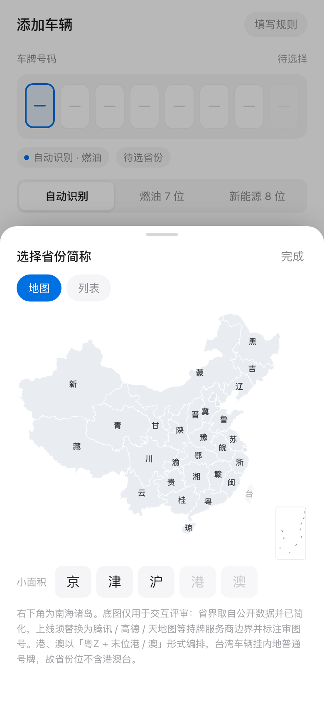
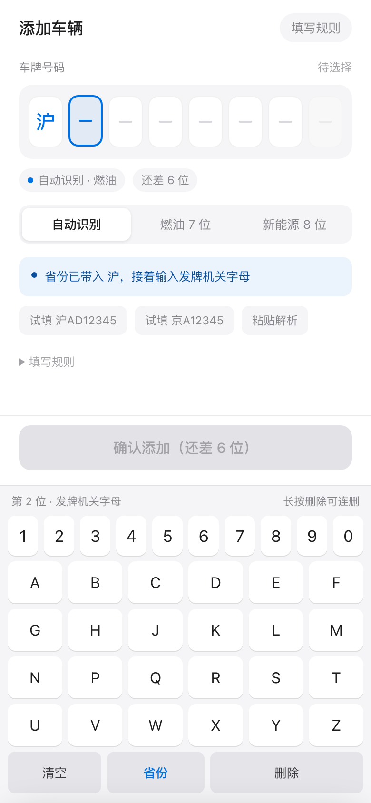
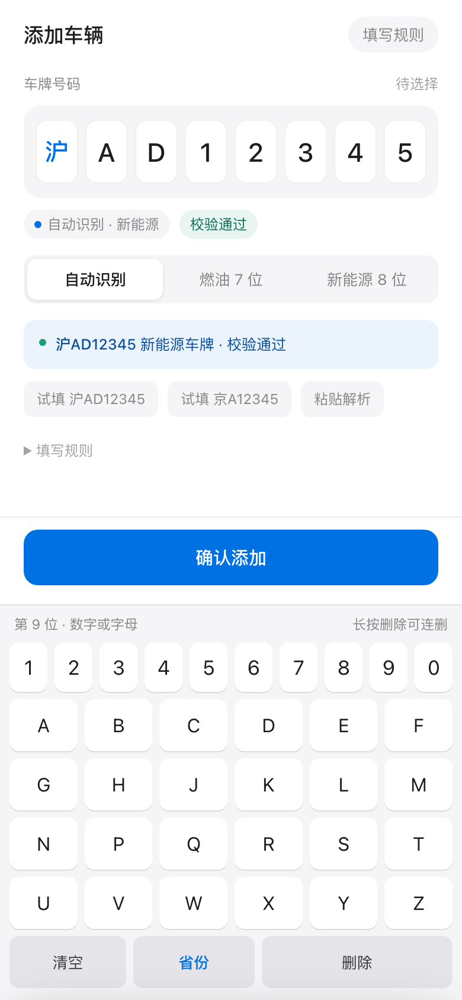
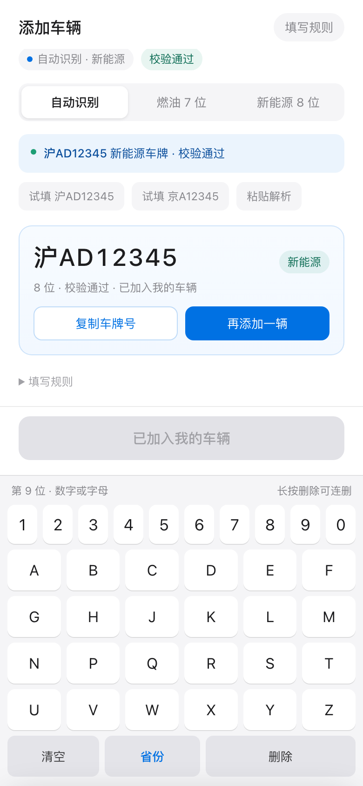

# 车牌号录入原型

一个移动端车牌号输入原型：首屏直接弹出省份地图，选完即进入字母输入；支持燃油 / 新能源 / 港澳入境三类号牌，边输边校验。

- 在线预览：https://plate-number-input.app.workbuddy.host/?sharecode=AQ6SMWFHFH
- 单文件、零依赖，双击 `index.html` 即可运行

<table>
  <tr>
    <td align="center"> 首屏弹出省份地图</td>
    <td align="center"> 列表视图兜底</td>
    <td align="center"> 选完直接进字母输入</td>
  </tr>
  <tr>
    <td align="center"> 小型新能源 沪AD12345</td>
    <td align="center"> 校验通过生成结果卡</td>
    <td align="center"> 粤Z 末位选港 / 澳</td>
  </tr>
</table>

## 设计取向

省份不用「找」，用「指」：首屏直接把地图摊开，用户指到自己的省，一次点击完成；选中后面板收起、光标落到字母位，后面全是打字。

如果后续接入车辆列表或扫码识牌，这两条路径应该排在省份选择之前——能省掉的步骤优先省掉。

## 功能

**车牌规则**

| 类型 | 位数 | 规则 | 示例 |
|---|---|---|---|
| 燃油 | 7 | 省 + 发牌机关字母 + 5 位数字或字母 | 沪A12345 |
| 小型新能源 | 8 | 省 + 字母 + 第 3 位 D/F + 5 位 | 沪AD12345 |
| 大型新能源 | 8 | 省 + 字母 + 5 位数字 + 末位 D/F | 沪A12345D |
| 港澳入境 | 7 | 粤 + Z + 4 位号码 + 末位「港」或「澳」 | 粤Z1234港 |

字母为 A–Z，不含 I、O。

**交互**

- 首屏自动弹出省份面板，停在「地图」视图；另有「列表」视图按七大区分组兜底
- 点省份格可随时改省份；未选省份时关闭面板，焦点留在省位
- 自绘键盘：数字行 + 24 字母 4×6 + 清空 / 省份 / 删除
- 键盘状态条实时提示当前位规则（如「第 3 位 · 新能源固定 D 或 F」「第 7 位 · 选择 港 或 澳」）
- 删除键长按连删；清空需两步确认
- 新能源模式下自动高亮 D、F 键；粤Z 输入到末位时键盘切换为「港 / 澳」
- 支持物理键盘输入、示例试填、剪贴板解析

## 文件

| 文件 | 说明 |
|---|---|
| `index.html` | 地图版（默认入口），真实分省轮廓 + 小面积省份外挂行 |
| `group.html` | 分组版，七大区分组行，无地图 |
| `docs/shots/` | 功能截图 |

## 合规

地图版的省界取自公开数据并做简化，**仅用于交互评审**。上线须替换为腾讯位置服务 / 高德 / 天地图等持牌服务商的边界数据，保证完整国界、台湾与南海诸岛，并按规定标注审图号。

港、澳以「粤Z + 末位港/澳」形式编排，台湾车辆挂内地普通号牌，因此省份位仍为 31 个省级简称。
